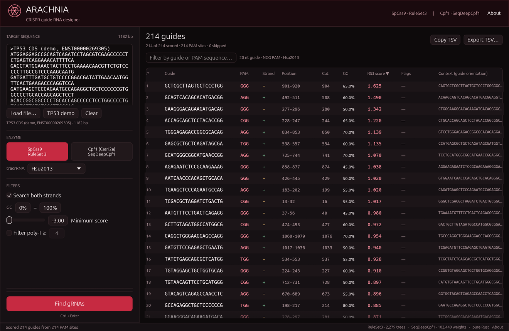
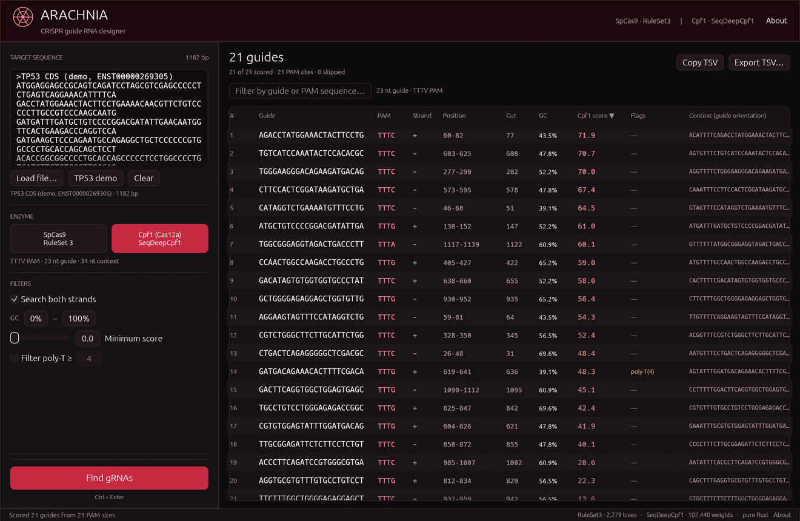

# Arachnia

A CRISPick-style desktop application for designing **on-target CRISPR guide
RNAs** and finding **Cas-OFFinder-style off-target sites**, written entirely in
Rust. It ranks SpCas9 guides with **Rule Set 3** (the LightGBM model from
[`gpp-rnd/rs3`](https://github.com/gpp-rnd/rs3)) and Cpf1/Cas12a guides with
**SeqDeepCpf1**
([`alisakumbara/SeqDeepCpf1-Py3`](https://github.com/alisakumbara/SeqDeepCpf1-Py3)).

No Python runtime is needed: both models, their feature extraction / inference
code, and the off-target search engine are embedded in the application.



## Features

- **SpCas9** — 20 nt guide + `NGG` PAM, scored with Rule Set 3 sequence mode.
  Select the Hsu2013 (default) or Chen2013 tracrRNA; the choice is part of the
  model input.
- **Cpf1 (Cas12a)** — 23 nt guide + `TTTV` PAM, scored with SeqDeepCpf1 on the
  paper's 0–100 activity scale.
- Searches the plus and minus strands. Guide and PAM are shown in guide
  orientation; coordinates are 1-based on the input (plus) strand.
- Sortable results table with guide, PAM, strand, position, cut site, GC,
  score, flags, and the exact model context.
- Live filters for GC content, minimum score, poly-T runs and guide/PAM
  substring.
- Selected-guide detail panel with the exact model context and approximate cut
  site.
- **Off-target analysis** for the selected guide: exact IUPAC PAM matching,
  Hamming mismatches over the guide, both strands, and a mismatch-ranked table.
  Search the current target sequence or a loaded FASTA reference, with
  background loading/search, progress and cancellation. A local hg38 is
  auto-detected and preselected; `scripts/fetch_hg38.sh` installs it.
- Export visible on-target results or off-target sites as TSV. Off-target TSV
  uses Cas-OFFinder's columns and 0-based locations.
- Built-in TP53 CDS demo, so the app is useful immediately.
- Offline and self-contained: the RuleSet3 ensemble and SeqDeepCpf1 weights
  are embedded in the binary.
- A `cas-offinder` command-line binary exposes the same off-target engine with
  Cas-OFFinder's input-file format and accepts `hg38`/`GRCh38` as the reference
  shorthand.

Cpf1 designs use the same interface and report SeqDeepCpf1 activity scores:



## Building and running

Requirements:

- Rust 1.88 or newer (edition 2021).
- Linux: the usual X11/Wayland development libraries required by `eframe`
  (`libxkbcommon`, `libx11`, `libwayland`, OpenGL drivers). On Debian/Ubuntu:

  ```bash
  sudo apt install build-essential pkg-config libxkbcommon-dev libx11-dev \
       libwayland-dev libgl1-mesa-dev
  ```

- macOS and Windows are supported by `eframe` as well.

Build a release binary:

```bash
cargo build --release
./target/release/arachnia
```

or run directly:

```bash
cargo run --release
```

The first build downloads and compiles `eframe`/`egui` and `seqfold`, so it may
take a few minutes.

## Using the app

1. Paste a DNA sequence or FASTA record into the target box, or click
   **Load file…**. **TP53 demo** restores the built-in example.
2. Choose **SpCas9** or **Cpf1 (Cas12a)**. For Cas9, pick the tracrRNA variant.
3. Adjust the GC range, minimum score and optional poly-T filter. These filter
   the already-scored candidates live; they do not rescore.
4. Press **Find gRNAs** (or `Ctrl+Enter`). Changing the enzyme, tracrRNA or
   strand setting automatically rescans if results are already displayed.
5. Click a row to open the selected-guide panel; use **Copy guide**,
   **Copy context**, **Copy TSV** or **Export TSV…** to take results with you.
6. Click **Off-targets…** in the selected-guide panel to open the off-target
   window. Choose the PAM pattern and mismatch limit, then search the current
   target sequence or a reference genome. If hg38 is installed locally, the
   window preselects it; **Use hg38** loads it in one click.

The guide sequence and PAM are presented in guide orientation (5′→3′), so a
Cas9 PAM always reads `NGG` and a Cpf1 PAM always reads `TTTV`. On the minus
strand the corresponding plus-strand PAM is the reverse complement.

### Input

- Plain DNA, FASTA, or lower-case sequence.
- `U` is treated as `T`; `N` is accepted, but any candidate whose model context
  contains `N` is skipped and counted in the status line.
- If a FASTA file contains multiple records, only the first is used for
  on-target design and a warning is shown. Off-target genome search loads every
  record.

## Off-target analysis

Open the off-target window from a selected guide. The search follows the
Cas-OFFinder model:

- The PAM must match the supplied IUPAC pattern exactly. For Cas9 the pattern
  is 3′ of the guide (`NGG` by default); for Cpf1 it is 5′ of the guide
  (`TTTV` by default). The window shows the guide and PAM in guide
  orientation.
- Mismatches are counted over the guide only, using Hamming distance. The PAM
  is not included in the mismatch count.
- Both strands are searched by default. Reported locations are **0-based** and
  refer to the left edge of the guide + PAM window on the plus strand, the same
  convention as Cas-OFFinder and Bowtie.
- **Current target sequence** searches only the sequence in the main target
  box. **Reference genome** loads a FASTA file, or a directory containing
  `.fa`, `.fasta`, `.fna`, `.fas`, `.ffn` or `.seq` files (case-insensitive,
  sorted by filename). Compressed FASTA is not supported. If a local hg38 is
  found, it is preselected; **Use hg38** loads it directly.
- Genome loading and searching run on background threads. The progress bar
  reports scanned windows, and **Cancel** stops an in-flight search.
- Windows containing ambiguous bases in the guide are skipped. Results are
  capped at 200,000 sites per search.
- DNA and RNA **bulges are not supported**. Only exact-PAM, mismatch-only
  off-targets are enumerated.

Results can be copied or exported as Cas-OFFinder-compatible TSV with the
columns `Id`, `Bulge Type`, `crRNA`, `DNA`, `Chromosome`, `Location`,
`Direction`, `Mismatches` and `Bulge Size`.

### Using hg38

Genome-wide off-target searches should use the human GRCh38/hg38 reference.
Arachnia does not bundle it (the FASTA is about 3.1 GiB); install a local copy
with:

```bash
./scripts/fetch_hg38.sh
```

The script downloads UCSC `hg38.fa.gz` (about 940 MiB compressed), verifies its
MD5 when available, decompresses it, and writes
`${XDG_DATA_HOME:-$HOME/.local/share}/arachnia/hg38.fa`. It is idempotent and
can be redirected with `ARACHNIA_HG38_DIR`. Set `ARACHNIA_HG38` to point at an
existing FASTA file or directory instead. hg38 is not bundled with Arachnia;
see the [UCSC Genome Browser data usage policy](https://genome.ucsc.edu/license/)
if you redistribute the reference.

The app and CLI look for hg38 in this order:

1. `$ARACHNIA_HG38` (file or directory)
2. `$ARACHNIA_HG38_DIR/hg38.fa`
3. `$XDG_DATA_HOME/arachnia/hg38.fa`
4. `~/.local/share/arachnia/hg38.fa`
5. `~/genomes/hg38.fa`, `~/genomes/hg38.fasta`, `~/hg38.fa`
6. `/data/genomes/hg38.fa`, `/srv/genomes/hg38.fa`

In the app, open **Off-targets…**; the reference-genome radio is already
selected and the hg38 path is filled in when a copy is found. Click **Load**
or **Use hg38** before searching. The genome is loaded into memory on a
background thread (roughly 3.1 GiB of RAM for hg38). The CLI accepts `hg38` or
`GRCh38` as the first input line and resolves it through the same search.

An optional end-to-end smoke test checks a TP53 guide against the local hg38:

```bash
cargo test --release --test hg38_smoke -- --ignored --nocapture
```

## Command-line off-target search

Build the CLI:

```bash
cargo build --release --bin cas-offinder
```

Run it with a Cas-OFFinder-style input file:

```bash
./target/release/cas-offinder input.txt -            # TSV to stdout
./target/release/cas-offinder input.txt C out.tsv    # device argument accepted, ignored
```

Input format:

```text
hg38
NNNNNNNNNNNNNNNNNNNNNGG
GAGCGCTGCTCAGATAGCGANNN 3 tp53
```

The first line is `hg38`/`GRCh38` (resolved as described above) or a FASTA file
or a directory of FASTA files. The second line is the pattern (with optional
`dna_bulge rna_bulge` sizes; both must be `0`). Each remaining line is
`query max_mismatches [id]`.

Cas9-style queries put the PAM wildcards at the 3′ end (`guideNNN`). Cpf1-style
queries put them at the 5′ end, with a matching pattern:

```text
hg38
TTTVNNNNNNNNNNNNNNNNNNNNNNN
NNNNAATGGAGTCGTGAGCGCAAGAAC 3 cpf1_guide
```

The CLI writes the same TSV columns as the GUI, including the `##Generated by
Arachnia` comment line. The optional device argument (`C`, `G`, `A`, or a
device list) is accepted for Cas-OFFinder command-line compatibility; the Rust
implementation always uses the CPU via Rayon.

## Scoring details

### Rule Set 3 (SpCas9)

The input context is 30 nt:
`[4 nt upstream][20 nt guide][3 nt PAM][3 nt downstream]`.

The 632 features are reproduced exactly as in `sglearn.featurize_guides` plus
the two tracrRNA one-hot columns:

- GC content and A/C/T/G fractions of the guide.
- 16 non-overlapping dinucleotide fractions (Python `str.count` semantics,
  so `"AAA".count("AA") == 1`).
- Position-specific one-hot bases for `-4..-1`, `1..20`, `P1..P3`, `+1..+3`.
- Position-specific dinucleotides (29 adjacent pairs).
- 16 P1/+1 PAM-interaction features.
- Five thermodynamic features: DNA/DNA Tm (`DNA_NN3`), RNA/DNA Tm
  (`R_DNA_NN1`), SeqFold ΔG, and RNA/DNA Tm for guide halves 1–10 and 11–20.
  The Tm code follows Biopython `MeltingTemp.Tm_NN` defaults and `saltcorr=5`;
  SeqFold is used through its pure-Rust engine with sglearn's special-value
  mapping.
- Longest A/C/T/G homopolymer runs.
- Hsu2013 / Chen2013 tracrRNA one-hot.

The 2,279-tree LightGBM ensemble is traversed directly in Rust. Scores are the
raw model output: higher is more active.

### SeqDeepCpf1 (Cpf1)

The input context is 34 nt:
`[4 nt upstream][4 nt TTTV PAM][23 nt guide][3 nt downstream]`.

The network is the original Keras 1-D CNN, evaluated with the official weights:

`Conv1d(4→80, k=5) → ReLU → AvgPool1d(2) → Flatten → 1200→80→40→40→1`.

Weights are converted once with the same transformations as the PyTorch
reference (`permute`/`flip` for the convolution, transposed dense kernels) and
stored in `assets/seqdeepcpf1_weights.bin`. The output is the predicted activity
on a 0–100 scale.

## Validation

`cargo test` checks:

- RuleSet3 featurization and inference against **84 regression cases**
  generated by the reference Python stack (contexts, both tracrRNAs, expected
  scores). Tolerance: `1e-9`.
- The two SeqDeepCpf1 example contexts from the upstream repository
  (`55.6993`, `53.4698`). Tolerance: `1e-3`.
- Biopython-compatible Tm values (several guides, including poly-A/T).
- Candidate coordinates, both strands, PAM matching, ambiguous-base skipping,
  and context assembly.
- Off-target enumeration against a naive reference implementation over
  randomized genomes, including both strands, IUPAC PAMs, 3′ Cas9 PAMs and 5′
  Cpf1 PAMs.
- End-to-end `cas-offinder` CLI tests for Cas9 and Cpf1 input files, mismatch
  lower-casing, 0-based locations, bulge rejection, and `hg38` alias
  resolution.
- Optional hg38 smoke test: the TP53 guide `GAGCGCTGCTCAGATAGCGA` + `TGG` is
  found at `chr17:7675051` on the minus strand of UCSC hg38 (455 contigs,
  3,209,286,105 bp). A three-mismatch search completes in about 5 s after the
  reference is loaded.

## Regenerating the embedded models

The model assets are already checked in. To regenerate them from the upstream
repositories:

```bash
mkdir -p .refs
git clone --depth 1 https://github.com/gpp-rnd/rs3 .refs/rs3
git clone --depth 1 https://github.com/alisakumbara/SeqDeepCpf1-Py3.git .refs/seqdeepcpf1
git clone --depth 1 https://github.com/Lattice-Automation/seqfold .refs/seqfold

python3 -m venv .refs/venv
.refs/venv/bin/pip install joblib scikit-learn lightgbm sglearn h5py numpy biopython
.refs/venv/bin/python scripts/export_models.py
```

The script writes:

- `assets/rs3_model.bin` — flattened LightGBM trees.
- `assets/rs3_features.json` — reference feature order.
- `assets/rs3_tests.json` — 84 regression vectors.
- `assets/seqdeepcpf1_weights.bin` — converted CNN weights.

## Limitations

- **Off-target search is mismatch-only.** The PAM must match exactly, DNA/RNA
  bulges are not considered, and no CFSS or variant-aware scoring is computed.
  Results are capped at 200,000 sites per search.
- Genome-wide searches load the reference into memory; compressed FASTA files
  are not supported.
- Rule Set 3 is used in **sequence mode**. The optional target-context model in
  the upstream package is not included.
- Cut positions are approximate. Cas9 cuts 3 bp upstream of the PAM; Cpf1
  produces a staggered cut around positions 18/23 of the protospacer.
- The poly-T flag warns about potential U6 termination, but filtering is off by
  default.
- SeqDeepCpf1 was trained on the original paired-library data; treat scores as
  relative rankings, not absolute editing efficiencies.
- This is a design aid, not a substitute for experimental validation.

## Licenses and citations

- Original application code: MIT.
- Rule Set 3 model: Apache-2.0, `gpp-rnd/rs3`.
- SeqDeepCpf1 code and weights: MIT, `alisakumbara/SeqDeepCpf1-Py3`.
- SeqFold: MIT, Lattice Automation.
- Biopython thermodynamic tables/algorithm: Biopython License Agreement
  (BSD-3-Clause-like).
- Cas-OFFinder: BSD-3-Clause, Jeongbin Park and Sangsu Bae. The Rust engine is
  an independent reimplementation of its search model and output format.
- Rayon: MIT or Apache-2.0.
- `egui`/`eframe`: MIT or Apache-2.0.

See [`THIRD_PARTY_LICENSES.md`](THIRD_PARTY_LICENSES.md) for details.

References:

- Kim, H. et al. Deep learning improves prediction of CRISPR–Cpf1 guide RNA
  activity. *Nature Biotechnology* **36**, 239–241 (2018).
  <https://doi.org/10.1038/nbt.4061>
- Bae, S., Park, J. & Kim, J.-S. Cas-OFFinder: a fast and versatile algorithm
  that searches for potential off-target sites of Cas9 RNA-guided
  endonucleases. *Bioinformatics* **30**, 1473–1475 (2014).
  <https://doi.org/10.1093/bioinformatics/btu048>
- Rule Set 3 / GPP: <https://github.com/gpp-rnd/rs3>
- crisprScore (crisprVerse): <https://github.com/crisprVerse/crisprScore>
- SeqDeepCpf1-Py3: <https://github.com/alisakumbara/SeqDeepCpf1-Py3>
- Cas-OFFinder: <https://github.com/snugel/cas-offinder>
